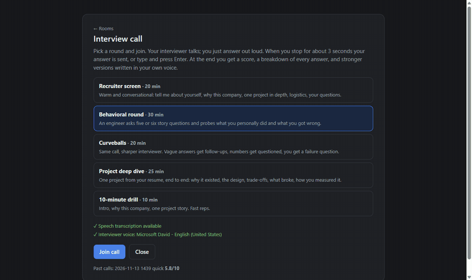
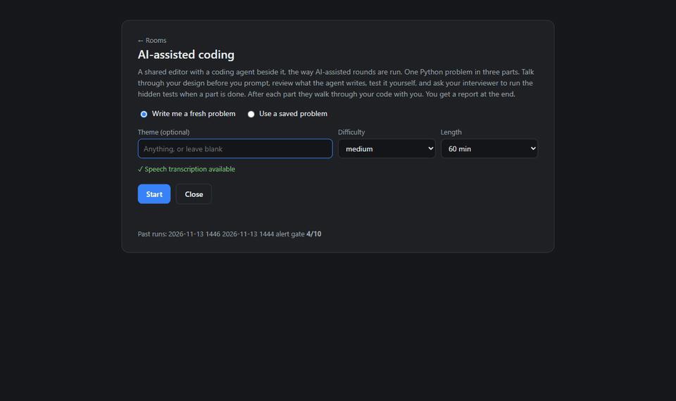
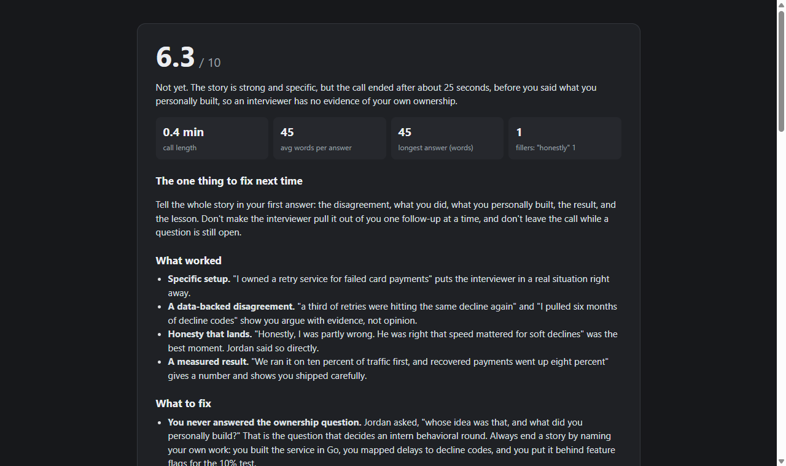

<h1 align="center">Interview Room</h1>

<p align="center"><b>A mock interview that talks, listens, watches the clock, and grades you at the end.</b><br>
It runs on the Claude Code or Codex sign-in you already have, so there is no API key and nothing to pay per call.</p>

<p align="center">
  
</p>

## How it works

1. **Talk.** You answer out loud. The browser's built-in speech recognition (Chrome and Edge) turns your voice into text, and after about three seconds of silence your answer is sent. You can also type.
2. **Listen.** The interviewer's reply is read aloud with your system's text-to-speech voice. Your camera sits in the tile next to theirs, so it feels like a real call.
3. **Interview.** Each turn is one run of `claude -p` (or `codex exec`) in the background, playing an interviewer with a fixed flow: when to dig into a story, when to move on, how to pace against the clock, when to say goodbye.
4. **Code.** The second room is an AI-assisted coding round: a shared editor, a coding agent panel with Plan, Edit and Ask modes, and a three-part problem written fresh for you. The interviewer answers clarifying questions, runs hidden tests when you say a part is done, and walks through the lines the agent wrote.
5. **Report.** When the call ends, a separate grader reads the whole transcript (and your code) and writes a report: a score, the one thing to fix, what worked, what to fix, and for every question, what you said next to a better answer in your own voice.

Nothing in this repo is tied to a company or a question bank. You tell it who you are and what you are practicing for, and every problem is written on the spot.

## System design

Everything runs on your computer. The browser handles voice in and out, a small Python server keeps each session's hidden state, and every model call goes through a CLI you are already signed in to.

```
  you: mic, camera, keyboard
            |
            v
+--------------------------- browser (Chrome or Edge) ----------------------------+
|  speech recognition      call tiles + camera      editor + agent panel          |
|  your voice -> text      live transcript          yellow lines = agent's edits  |
|  speech synthesis: the interviewer's text -> a voice                            |
+------------------------------------+--------------------------------------------+
                                     |  HTTP on 127.0.0.1:8660
                                     v
+--------------------------------- server.py -------------------------------------+
|  profile.json       who you are, the role, the company (never leaves your disk) |
|  session state      interviewer prompt, answer key, hidden tests (not sent to   |
|                     the page, so they stay hidden)                              |
|  runner.py          your tests and the hidden tests, in a throwaway folder      |
+------------------------------------+--------------------------------------------+
                                     |  one CLI run per turn: claude -p  or  codex exec
                                     v
  +----------------+  +-------------+  +------------------+  +-------------+
  |  interviewer   |  |    agent    |  |  problem writer  |  |   grader    |
  |  keeps one     |  |  Plan, Edit |  |  3 parts, hidden |  |  reads the  |
  |  session going |  |  or Ask     |  |  tests, and a    |  |  whole call |
  |                |  |             |  |  reference       |  |  and code   |
  +----------------+  +-------------+  +--------+---------+  +------+------+
                                                |                   |
                  hidden tests the reference    |                   v
                  fails are dropped  <----------+        +---------------------+
                                                         |  report             |
                                                         |  score and verdict  |
                                                         |  the one thing to   |
                                                         |  fix next time      |
                                                         |  answer by answer,  |
                                                         |  with better ones   |
                                                         |  delivery: fillers, |
                                                         |  answer length      |
                                                         +----------+----------+
                                                                    |
                                                                    v
                                                    sessions/ (json + .md report)
```

## The two rooms

**Interview call.** Five rounds: a recruiter screen, a behavioral round (it asks what *you* did when you say "we"), a curveballs version that pushes on vague answers, a project deep dive, and a 10-minute drill. The report counts filler words and answer length from your transcribed speech and rewrites each answer in your voice, using only facts from your profile. Where it needs a fact you didn't give, it writes `[your real example]` instead of inventing one.

**AI-assisted coding.** One Python problem in three parts that build on each other, like a small piece of a real product. The problem writer also writes a reference solution and hidden tests, and the server runs those tests against the reference before you start: any test the reference fails is dropped, so a bad test never fails you. Part 2 and Part 3 appear only after the interviewer has walked through your code. Every problem is saved in `exercises/`, and you can add your own (see [`exercises/README.md`](exercises/README.md)).

<p align="center"></p>

The coding report scores six things: design judgment, engineering fundamentals, code ownership, how you used the agent, testing and debugging, and communication. It quotes your prompts and rewrites the weakest one.

<p align="center"></p>

## Run it

You need Python 3.10 or newer, Chrome or Edge, and one of [Claude Code](https://claude.com/claude-code) or [Codex CLI](https://github.com/openai/codex), signed in.

```bash
git clone https://github.com/EnesYilmazcode/InterviewRoom
cd InterviewRoom
python server.py                    # or double-click Start.bat on Windows (standard library only)
ROOM_BACKEND=codex python server.py # use Codex instead of Claude Code
python -m unittest discover -s tests
```

The server opens the room in its own Chrome window at `http://127.0.0.1:8660`. Allow the microphone and camera once. Open **Your profile** on the first page and paste your resume as text, so the interviewer asks about your real work and the report checks your answers against it.

Model calls use your Claude Code or Codex plan, not an API key. In testing, an interviewer turn took about 4 seconds on Claude Code and about 10 on Codex, writing a fresh three-part problem took about 80 seconds, and a report about a minute. Edge ships the most natural-sounding voices; set `ROOM_CHROME` to its path to use it instead of Chrome.

| Setting | What it does |
|---|---|
| `ROOM_BACKEND` | `claude` (default) or `codex` |
| `ROOM_MODEL_INTERVIEWER`, `ROOM_MODEL_AGENT`, `ROOM_MODEL_WRITER`, `ROOM_MODEL_GRADER` | Claude model per role, default `sonnet` and `opus` for the grader |
| `ROOM_CODEX_MODEL` | Codex model, if you want something other than its default |
| `ROOM_PORT` | port for the local server, default `8660` |
| `ROOM_CHROME` | path to Chrome or Edge, if it is somewhere unusual |

| Path | What's in it |
|---|---|
| [`server.py`](server.py) | the local server: pages, sessions, routes for both rooms |
| [`backend.py`](backend.py) | one model turn through `claude -p` or `codex exec` |
| [`prompts_call.py`](prompts_call.py) | the five call rounds and the call grader |
| [`prompts_coding.py`](prompts_coding.py) | the problem writer, coding interviewer, agent modes and coding grader |
| [`exercises.py`](exercises.py) | writes, checks, saves and loads problems |
| [`runner.py`](runner.py) | runs your tests and the hidden tests in a throwaway folder |
| [`candidate.py`](candidate.py) | your profile, kept in `profile.json` |
| [`web/`](web/) | the lobby, the call room, the coding room, shared voice and report code |
| [`exercises/`](exercises/) | your saved and hand-written problems (ignored by git) |
| [`tests/`](tests/) | the runner and the problem loader |

## Credits

Speech recognition and text-to-speech are the browser's [Web Speech API](https://developer.mozilla.org/docs/Web/API/Web_Speech_API). The editor is [CodeMirror 5](https://codemirror.net/5/) (MIT). The models come through [Claude Code](https://claude.com/claude-code) or [Codex CLI](https://github.com/openai/codex).
